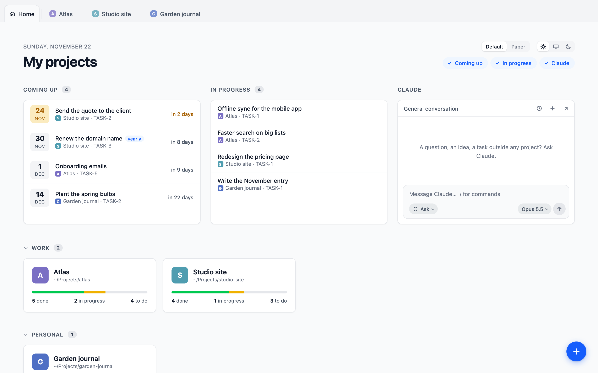
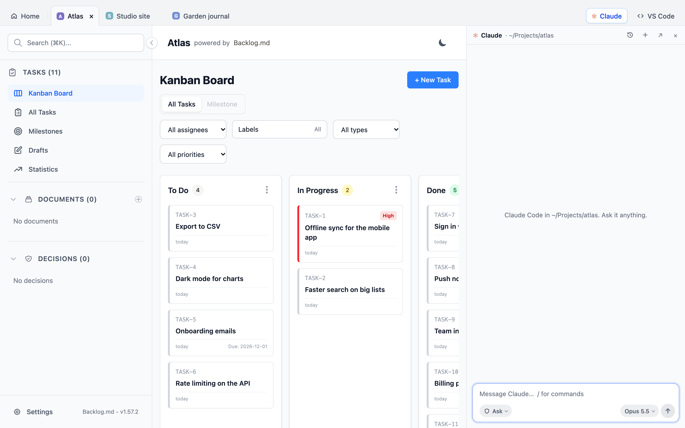
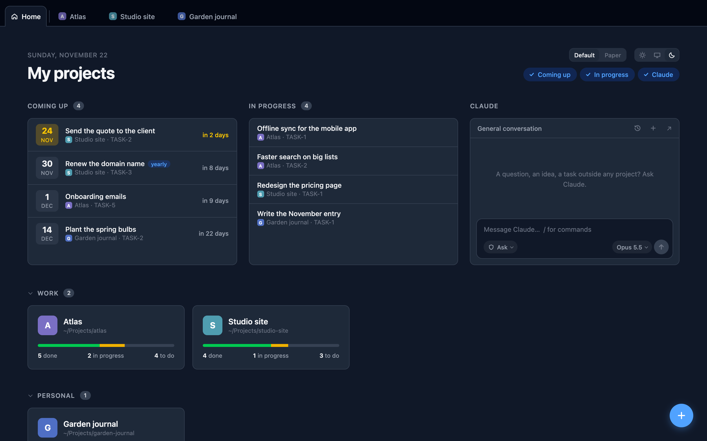

# Backlog Hub

A home page for every [Backlog.md](https://github.com/MrLesk/Backlog.md) board on your computer: a card per project with its task counts, a tab per open project, and a button to add a folder (a board is created in it if it has none). Site: https://corentingautier.dev/backlog-hub/ · [Ko-fi](https://ko-fi.com/corentingautier)

- **Projects**: cards grouped in categories you name and order by drag and drop.
- **Coming up**: open tasks with a due date, across every project, soonest first. A task labelled `monthly`, `quarterly` or `yearly` comes back once done.
- **Claude Code** beside each board (✻ Claude, or Ctrl+`), and a general chat on the home page. A conversation keeps running while the window is closed.
- **Encrypted docs** (macOS): a doc's Encrypt button keeps it encrypted on disk, unlocked with Touch ID (needs the fork below).





<details><summary>Dark</summary>



</details>

## Download

From the [latest release](https://github.com/corentin-gautier/backlog-hub/releases/latest):

- **macOS**: `Backlog-Hub-<version>-arm64.dmg` (Apple silicon) or `-x64.dmg` (Intel). Drag the app to Applications.
- **Windows**: `Backlog-Hub-Setup-<version>.exe`. The installer is not signed: Windows SmartScreen asks to confirm (More info › Run anyway).

Or with [Homebrew](https://brew.sh) (macOS):

```sh
brew tap corentin-gautier/tap
brew trust --cask corentin-gautier/tap/backlog-hub
brew install --cask corentin-gautier/tap/backlog-hub
```

Everything ships inside: the app's own Node and the `backlog` CLI (a `backlog` on your PATH, such as the fork, wins). The app opens at login (turn it off in its menu, or the tray menu on Windows); closing its window keeps it running. For the Claude Code panel, install the [`claude` CLI](https://docs.claude.com/en/docs/claude-code) and sign in.

## From source (macOS)

Needs [Node](https://nodejs.org) 20+, the `backlog` CLI (`brew install backlog-md` or `npm i -g backlog.md`) and, for encrypted docs, the Xcode Command Line Tools (`xcode-select --install`).

```sh
git clone https://github.com/corentin-gautier/backlog-hub.git && cd backlog-hub
./install.sh            # starts the server at every login, opens http://localhost:6400
./install.sh --uninstall
npm run app             # the desktop app on this checkout (it uses the server above when it runs)
```

Releases: `npm run release` takes the next version from the [Conventional Commits](https://www.conventionalcommits.org) since the last tag, writes its [CHANGELOG.md](CHANGELOG.md) section, builds, tags and publishes (`npm run release:dry` shows what it would do; `scripts/release.sh` header for the rest); the README's screenshots come from `scripts/screenshots.sh` (demo projects).

## Optional: the Backlog.md fork

Boards work with the standard `backlog`. A [fork](https://github.com/corentin-gautier/Backlog.md) adds a visual doc editor (docs edited where they are shown), the encryption controls on the doc page, and a theme that follows macOS. To build it and make it the `backlog` command (needs [Bun](https://bun.sh) and Homebrew on Apple Silicon):

```sh
scripts/backlog-fork.sh            # build and link
scripts/backlog-fork.sh --update   # rebase on upstream first
```

Homebrew's `backlog-md` is kept, unlinked: `brew link backlog-md` brings it back.

## How it works

- `server.js` serves `public/` on port 6400 and starts each board (`backlog browser --port P --no-open`) the first time its tab opens. A board already running on its port (a VS Code task, say) is reused.
- The project list is `~/Library/Application Support/Backlogs/projects.json`. On first run it holds every board found in `~/Projects` and `~/Documents` (git worktrees skipped).
- Each project keeps its config's `default_port`; a port already taken gets the next free one from 6430.
- Removing a project only takes it off the list.
- Claude Code panel: a chat with Claude Code in the project folder (the home folder for the general chat), run by `claude.js` with the Agent SDK and streamed to the page over a WebSocket. It stops when the project's tab is closed and picks up the same conversation next time.
- Log: `~/Library/Logs/Backlogs.log`. Run by hand: `npm install && node server.js`.
- Icons: `rsvg-convert -w 512 public/icon.svg -o public/icon-512.png` (and 192).

## Support

If Backlog Hub is useful to you, you can support my work with a small donation on [Ko-fi](https://ko-fi.com/corentingautier). Thank you!

[](https://ko-fi.com/corentingautier)

## License

[MIT](LICENSE)
